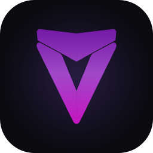
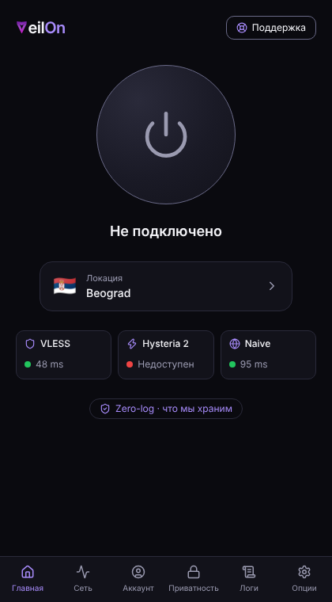
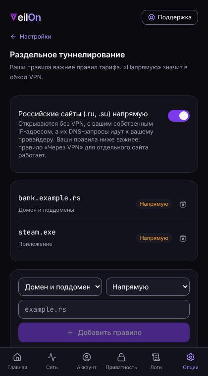
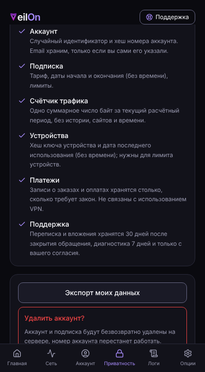

<p align="center">
  
</p>

<h1 align="center">Veil Connect</h1>

<p align="center">
  The open source VPN client of VeilOn for Windows, macOS, Linux and Android.
</p>

<p align="center">
  <a href="README.md"></a>
  <a href="README.ru.md"></a>
</p>

<p align="center">
  <a href="LICENSE"></a>
  
</p>

---

Veil Connect is the app you install to use VeilOn. We publish the full source
code so that anyone can check what the client does on your device: which
connections it opens, what it stores, and what it never sends.

<p align="center">
  
  
  
</p>

## Features

- **Several transports with automatic fallback.** VLESS + REALITY + XHTTP by
  default, VLESS + Vision, Hysteria 2 and NaiveProxy. If one of them is
  blocked, the client switches to another without making you do anything.
- **Kill switch.** While you are connected, nothing leaves the device outside
  the tunnel. It uses nftables on Linux, pf on macOS and Windows Firewall on
  Windows, and on Android it relies on the system "Always-on VPN" setting.
- **Split tunnelling.** Your own rules by domain, IP range or app, plus an
  optional preset that keeps Russian sites (.ru, .рф, .su and the geosite
  `category-ru` list) outside the VPN.
- **Private DNS.** DNS over HTTPS through the tunnel. Quad9 by default, with
  Cloudflare, Google, AdGuard, OpenDNS or your own server to choose from.
- **No leaks.** IPv6 is either tunnelled or blocked, never sent around the
  VPN. DNS queries never go to your provider.
- **Signed updates.** Releases are signed offline and checked before
  installing. Updates on Linux, macOS and Windows install silently.
- **Payments and support inside the app**, including an optional diagnostic
  report that shows you exactly what it contains before you send it.
- **Crash reports only with your consent.** Off by default. A report is
  cleaned of addresses, domains, paths and account data on your device, and
  you can read its exact text before it goes anywhere.
- **Languages:** English, Russian, Serbian.

## Privacy you can check

- The client keeps no history of your connections. Local logs stay on your
  device, are cleaned of IP addresses and domains, and are never sent
  automatically.
- No analytics, trackers or third party crash reporting SDKs. CI fails the
  build if one appears.
- `make nolog` runs the zero-log tests: the generated sing-box and Xray
  configs are checked against the pinned cores to make sure logging,
  connection history and DNS caching stay off.
- `make repro` builds the binaries twice from scratch and requires the
  results to be byte for byte identical.
- Everything VeilOn stores about you is listed in the
  [data inventory](https://github.com/VeilOn-Group/veil-shared/blob/main/data-inventory.yaml)
  in veil-shared. The app shows the same list on its privacy screen.

## How it works

On desktop the client is split into two processes:

- **veilond** is a small system service. It starts sing-box and Xray as child
  processes after checking their SHA-256 hashes, sets up the TUN interface and
  the kill switch, and talks to the VeilOn API. It refuses to start if anyone
  other than root (or Administrators) and the service account can modify its
  config or binaries.
- **The desktop app** (Wails + React) runs without any special rights. It
  talks to veilond over a local socket, and veilond checks the identity of
  the connecting process through the kernel on every connection.

On Android the core runs in the app through libbox, and the same Go code from
veil-shared generates the configuration, so the rules are identical on every
platform.

## Repository layout

| Directory | Contents |
|---|---|
| `veilond/` | the service (`veilond`), the silent updater (`veilon-updater`) and a command line tool (`veilonctl`) |
| `desktop/` | the desktop app: Wails v3 and React |
| `android/` | the Android app: Kotlin, Jetpack Compose, VpnService, libbox |
| `packaging/` | systemd units, LaunchDaemons, the MSI definition and sample configs |
| `tools/package/` | scripts that build deb, rpm, msi and pkg packages |

## Building

The client depends on [veil-shared](https://github.com/VeilOn-Group/veil-shared),
which must be checked out next to this repository:

```bash
git clone https://github.com/VeilOn-Group/veil-shared
git clone https://github.com/VeilOn-Group/Veil-Connect
cd Veil-Connect
```

Service and tests (Go 1.24 or newer):

```bash
make build        # veilond, veilon-updater and veilonctl in ./bin
make test vet     # unit tests and go vet
make nolog        # zero-log tests against the pinned sing-box
make repro        # reproducible build check
```

Desktop app (Go 1.26 or newer, Node.js 22; on Linux also GTK 4, WebKitGTK 6.0
and libsoup 3):

```bash
make desktop
```

Android: the build runs in a container with a pinned toolchain
(`android/toolchain.lock`: Go, OpenJDK 17, NDK, SDK 35, gomobile, Gradle), so
the result does not depend on your machine:

```bash
make android
```

Linux packages (deb and rpm):

```bash
SINGBOX_BIN=/path/to/sing-box XRAY_BIN=/path/to/xray make packages
```

Run `make help` to see every target.

## Service configuration

veilond reads a YAML file; see the examples in `packaging/linux`,
`packaging/macos` and `packaging/windows`. Main keys: `runtime_dir`,
`state_dir`, `log_dir`, `singbox` and `xray` (path and SHA-256), `naive`,
`api` (server URLs and certificate pins), `trust.root_keys`, `local_api`
(socket and allowed groups), `update` and `billing`. The file contains no
secrets.

## License

Veil Connect is free software under the
[GNU General Public License v3.0 or later](LICENSE) (full text in
[COPYING](COPYING)). Third party components and their licenses are listed in
[THIRD-PARTY-LICENSES.md](THIRD-PARTY-LICENSES.md).

The VeilOn name and logo are not covered by the license. If you publish a
fork, please use your own name and branding.
