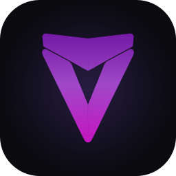
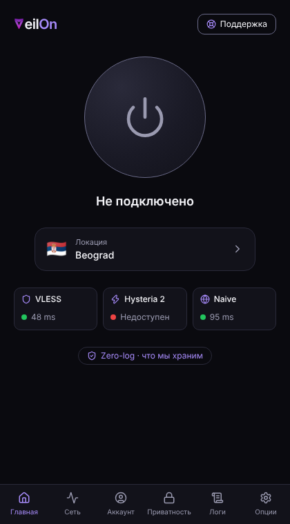
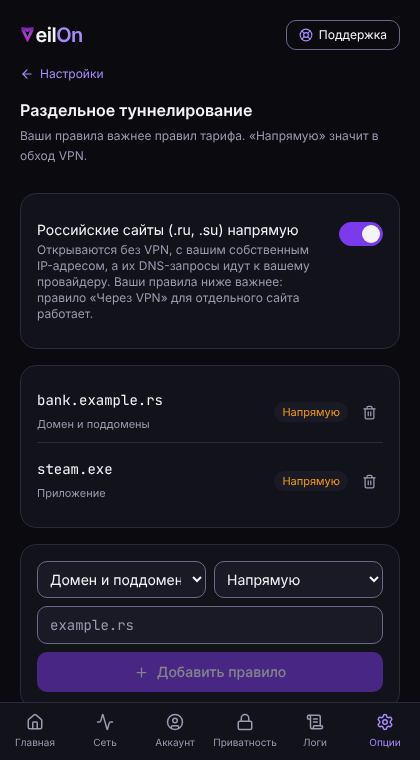
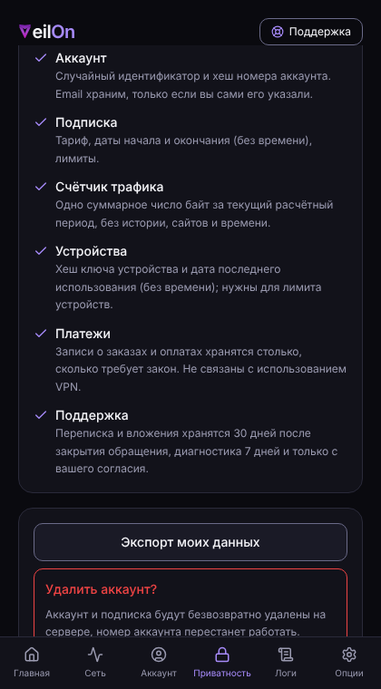

<p align="center">
  
</p>

<h1 align="center">Veil Connect</h1>

<p align="center">
  VPN-клиент VeilOn с открытым исходным кодом для Windows, macOS, Linux и Android.
</p>

<p align="center">
  <a href="README.md"></a>
  <a href="README.ru.md"></a>
</p>

<p align="center">
  <a href="LICENSE"></a>
  
</p>

---

Veil Connect это приложение, через которое вы пользуетесь VeilOn. Мы
публикуем исходный код целиком, чтобы любой мог проверить, что клиент делает
на вашем устройстве: какие соединения открывает, что хранит и чего никогда
не отправляет.

<p align="center">
  
  
  
</p>

## Возможности

- **Несколько протоколов и автоматическое переключение.** По умолчанию
  VLESS + REALITY + XHTTP, также VLESS + Vision, Hysteria 2 и NaiveProxy.
  Если один протокол заблокирован, клиент сам перейдёт на другой.
- **Kill switch.** Пока VPN включён, ни один пакет не уходит мимо туннеля.
  На Linux это nftables, на macOS pf, на Windows брандмауэр Windows, а на
  Android системная настройка «Постоянная VPN».
- **Раздельное туннелирование.** Свои правила по домену, диапазону IP или
  приложению, а также готовый набор, который пускает российские сайты (.ru,
  .рф, .su и список geosite `category-ru`) мимо VPN.
- **Защищённый DNS.** DNS over HTTPS через туннель. По умолчанию Quad9, на
  выбор Cloudflare, Google, AdGuard, OpenDNS или свой сервер.
- **Без утечек.** IPv6 либо идёт через туннель, либо блокируется, но никогда
  не обходит VPN. DNS-запросы не попадают к вашему провайдеру.
- **Подписанные обновления.** Релизы подписываются офлайн-ключом и
  проверяются перед установкой. На Linux, macOS и Windows обновления ставятся
  незаметно.
- **Оплата и поддержка прямо в приложении.** К обращению можно приложить
  диагностику, и перед отправкой вы видите её полностью.
- **Отчёты о сбоях только с вашего согласия.** По умолчанию выключены. Отчёт
  очищается от адресов, доменов, путей и данных аккаунта ещё на устройстве, и
  его точный текст можно прочитать до отправки.
- **Языки:** русский, английский, сербский.

## Приватность, которую можно проверить

- Клиент не хранит историю ваших подключений. Локальные логи остаются на
  устройстве, очищены от IP-адресов и доменов и никогда не отправляются
  сами по себе.
- Никакой аналитики, трекеров и сторонних SDK для отчётов о сбоях. Если такой
  код появится, сборка в CI упадёт.
- `make nolog` запускает тесты zero-log: сгенерированные конфиги sing-box и
  Xray проверяются закреплёнными версиями ядер, чтобы логирование, история
  соединений и кеш DNS оставались выключенными.
- `make repro` дважды собирает бинарники с нуля и требует, чтобы результаты
  совпадали байт в байт.
- Всё, что VeilOn хранит о пользователе, перечислено в
  [реестре данных](https://github.com/VeilOn-Group/veil-shared/blob/main/data-inventory.yaml)
  в veil-shared. Тот же список приложение показывает на экране приватности.

## Как это устроено

На компьютере клиент состоит из двух процессов:

- **veilond** это небольшая системная служба. Она запускает sing-box и Xray
  дочерними процессами, предварительно сверив их SHA-256, настраивает
  TUN-интерфейс и kill switch и общается с API VeilOn. Служба не запустится,
  если её конфиг или бинарники может изменить кто-то кроме root (или
  администраторов) и учётной записи службы.
- **Приложение** (Wails + React) работает без особых прав. Оно общается с
  veilond через локальный сокет, а veilond при каждом подключении проверяет
  через ядро ОС, какой процесс к нему обращается.

На Android ядро работает внутри приложения через libbox, а конфигурацию
генерирует тот же Go-код из veil-shared, поэтому правила одинаковы на всех
платформах.

## Структура репозитория

| Каталог | Что внутри |
|---|---|
| `veilond/` | служба (`veilond`), фоновый установщик обновлений (`veilon-updater`) и консольная утилита (`veilonctl`) |
| `desktop/` | приложение для компьютера: Wails v3 и React |
| `android/` | приложение для Android: Kotlin, Jetpack Compose, VpnService, libbox |
| `packaging/` | юниты systemd, LaunchDaemon, описание MSI и примеры конфигов |
| `tools/package/` | скрипты сборки пакетов deb, rpm, msi и pkg |

## Сборка

Клиенту нужен [veil-shared](https://github.com/VeilOn-Group/veil-shared),
он должен лежать рядом с этим репозиторием:

```bash
git clone https://github.com/VeilOn-Group/veil-shared
git clone https://github.com/VeilOn-Group/Veil-Connect
cd Veil-Connect
```

Служба и тесты (Go 1.24 или новее):

```bash
make build        # veilond, veilon-updater и veilonctl в ./bin
make test vet     # юнит-тесты и go vet
make nolog        # тесты zero-log на закреплённом sing-box
make repro        # проверка воспроизводимости сборки
```

Приложение для компьютера (Go 1.26 или новее, Node.js 22; на Linux ещё
GTK 4, WebKitGTK 6.0 и libsoup 3):

```bash
make desktop
```

Android собирается в контейнере с закреплённым набором инструментов
(`android/toolchain.lock`: Go, OpenJDK 17, NDK, SDK 35, gomobile, Gradle),
поэтому результат не зависит от вашей машины:

```bash
make android
```

Пакеты для Linux (deb и rpm):

```bash
SINGBOX_BIN=/путь/к/sing-box XRAY_BIN=/путь/к/xray make packages
```

Все цели показывает `make help`.

## Настройка службы

veilond читает YAML-файл, примеры лежат в `packaging/linux`,
`packaging/macos` и `packaging/windows`. Основные ключи: `runtime_dir`,
`state_dir`, `log_dir`, `singbox` и `xray` (путь и SHA-256), `naive`, `api`
(адреса серверов и пины сертификатов), `trust.root_keys`, `local_api` (сокет
и разрешённые группы), `update` и `billing`. Секретов в файле нет.

## Лицензия

Veil Connect это свободное ПО под лицензией
[GNU GPL v3.0 или более поздней версии](LICENSE) (полный текст в
[COPYING](COPYING)). Сторонние компоненты и их лицензии перечислены в
[THIRD-PARTY-LICENSES.md](THIRD-PARTY-LICENSES.md).

Название и логотип VeilOn под лицензию не попадают. Если публикуете форк,
используйте, пожалуйста, своё название и оформление.
